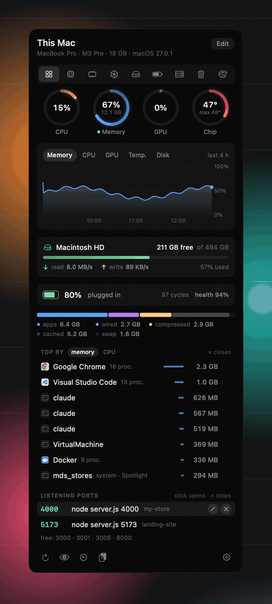

<div align="center">


# Barometer

**Your Mac, live, in the menu bar.**

Memory, CPU, GPU, disk, battery and temperatures in a panel that opens with one click.<br>
What is eating your Mac, and the ports left open, with a × to stop what shouldn't be running.

[](#install)
[](#limits)
[](#for-tinkerers)
[](LICENSE)
[](#languages)

[Install](#install) · [Features](#features) · [How to use it](#how-to-use-it) · **English** · [Português](README.pt-BR.md)

<br>



</div>

## Install

You need a Mac with Apple silicon, macOS 14 or later, and Apple's command line tools (`xcode-select --install`).
No Xcode, no Homebrew, no packages.

```sh
git clone https://github.com/GabrielTeles845/barometer.git
cd barometer
zsh instalar.sh
```

The installer compiles the app, builds `~/Applications/Barometer.app` and opens it, already set to open at login
(you can turn that off in the gear menu). Running it again over an existing install is safe.

## Features

**Overview.** The summary you build yourself: rings for CPU, memory, GPU and chip temperature, a history chart, disk,
battery, memory breakdown, top processes and open ports. **Edit** turns each card on or off, drags them into any
order, and sets how many processes the lists show (3, 5 or 8).

**CPU.** One bar per core, efficiency and performance cores apart, each cluster's frequency, load, uptime, chip, SSD
and battery temperatures, and the processes using the most CPU.

**Memory.** Usage and memory pressure (the same Activity Monitor shows), split into apps, wired, compressed, cached
and swap. The biggest users are grouped by app: Chrome and its thirty helpers become one line.

**GPU and Disk.** GPU usage, renderer, tiler and memory. Free space counted the way Finder counts it, live read and
write speeds, and totals since boot. Both with their own chart.

**Battery.** Charge, time left, and the **health** and **condition** exactly as System Settings shows them. Cycle
count, capacity, temperature, voltage, watts and the charger plugged in.

**Ports.** What is listening on each port, with the command and the project name (from `package.json` or the git
folder); Docker containers with their compose project. Click to open in the browser, **×** to stop it. Favorite
ports show up as free when nothing is using them.

**Cleanup.** First, what you could close: apps open but unused for over an hour (biggest first) and servers listening
for over 12 hours, like yesterday's `npm run dev`. Then app caches, npm, Bun and pnpm caches, Xcode DerivedData,
simulator caches and old logs, each with its size and what happens after cleaning. The Trash has its own button and
confirmation. Documents, downloads and photos are never touched.

**Appearance.** Eight ready-made styles to pick on first launch, from Classic to liquid-glass Sunset, plus
**Custom**, where you pick the color of each reading. **Light, dark, or following your Mac**, and a style never changes
that. Then make it yours: solid, frosted or **liquid glass** (macOS 26) with a transparency slider, six palettes, an
accent color, **flat colors** for those who'd rather skip the gloss, **colored icons** everywhere, three corner styles,
smooth, springy or no animation, and a colored menu bar icon.

**Menu bar.** Up to three things side by side, each with its icon: CPU, memory or GPU usage, chip temperature,
battery, free disk, open ports, or the little CPU and memory bars.

## How to use it

- **Click the icon** to open the panel, or press **⌃⌥B** from any app; click outside or press Esc to close it.
- **Keyboard in the panel:** ⌘1 to ⌘9 jump to each tab, the arrow keys step through them, ⌘R refreshes, ⌘, opens
  the settings.
- **Drag the tab pill** across the bar: it follows the mouse, stretches with your speed and snaps to the tab where you
  let go.
- **Hover any icon** to see its name.
- **Edit**, on the Overview, picks the cards, their order and what goes in the menu bar.
- **The ×** shows up when you hover a process or a port:
  - an **app** quits like Cmd+Q; if it hasn't quit after 5 seconds, Barometer offers to force it;
  - a **stray process** (a forgotten `npm run dev`) stops the whole job, like Ctrl+C in the terminal;
  - a **Docker container** is stopped with `docker stop`;
  - **system processes** have no ×.
- **The gear** has open at login, what goes in the menu bar, the shortcut (⌃⌥B, ⌥⌘B, ⌃⌥Space, ⌃⌥M or off), the
  alerts, favorite ports and the language.
- **Alerts**, all off until you turn them on: memory at the limit for a minute, chip above 95° for 30 seconds, disk
  under 10% free, battery at 20% off the charger, and a favorite port going down. Each one fires once and only again
  after things are back to normal.

## Light on your Mac

Barometer only reads what you can see.

- **Panel closed:** memory, CPU, temperature, GPU and disk every 10 seconds, through direct system calls, for the
  icon and the chart. Ports (`lsof`) only if their count is in the menu bar.
- **Panel open:** every 2 seconds, only what the open tab shows. The Appearance tab reads nothing; the Ports tab
  doesn't list processes.
- **Closing the panel** drops everything it drew from memory. About 30 MB with the panel open.
- One `ps` for both process lists; the official battery health at most every 10 minutes, only with the battery on
  screen.

## Safe to use

- **Nothing leaves your Mac.** No network, no account, no telemetry.
- **The × doesn't take down what it shouldn't.** It walks up the process tree to find the job and stops at the
  first shell: your terminal, your editor and your session are never targets. Finder, the Dock and Barometer itself
  have no ×. Before stopping anything, it checks that the process still owns the port. The proof is
  `provas/provar-encerrar.py`, which starts real processes and checks who dies.
- When it can't stop something, it tells you why instead of pretending it worked.

## Where every number comes from

Nothing is estimated: each number comes from where macOS itself reads it.

| What | From |
|---|---|
| Memory and pressure | `host_statistics64` and `kern.memorystatus_vm_pressure_level` |
| CPU per core | `host_processor_info`; core type from `cluster-type` in the device tree |
| CPU frequency | IOReport and the power controller's frequency table |
| Temperatures | Chip, SSD and battery sensors (Apple silicon HID services) |
| GPU | `IOAccelerator` → `PerformanceStatistics` |
| Disk | `IOBlockStorageDriver` → `Statistics`; free space the way Finder counts it |
| Battery | `AppleSmartBattery`, `IOPowerSources`; official health from `system_profiler` |
| Ports | `lsof`; the project by walking up from the process folder |
| Processes | `ps`, grouped by app |

## Limits

- **Apple silicon only** (M1 and later). Temperatures and frequencies come from internal Apple interfaces, the same
  ones Stats and macmon use. Tested on an M3 Pro with macOS 27; on other chips a sensor or a core type may be named
  differently, and a new macOS release may change them. If something reads wrong on your Mac, open an issue with
  your chip.
- **Liquid glass needs macOS 26.** On older versions the two glass styles are greyed out and the panel uses frosted.
  The glass itself is never tinted: on macOS 27 a dark tint turns it into a solid block, so the transparency slider
  darkens a separate layer on top.
- **No GPU frequency:** on the M3 Pro, Apple's state count doesn't line up with its frequency table, and a number
  there would be a guess.
- **The code is commented in Portuguese.** The interface speaks English, Portuguese and Spanish.

## Languages

English, Portuguese and Spanish. Barometer follows your Mac's language; you can pick another one from the gear menu.

## For tinkerers

A Swift package: `BarometerKit` holds the whole app, one folder per subject; the `Barometer` executable only
starts it; the tests use the library directly.

| Folder (`Sources/BarometerKit/`) | What's in it |
|---|---|
| `App/` | The app delegate, split by job: readings, menu bar icon, panel, actions, cleanup, settings, screenshots |
| `Leitores/` | Readers: memory and processes, CPU (IOReport), GPU, disk, battery, history, cleanup, the Mac's model |
| `Portas/` | Ports: the `lsof` scan, projects, and who the × stops |
| `Sistema/` | Sensors, tools, log, login item, preferences |
| `Painel/` | The panel in SwiftUI: state, tab bar, editor; `Cartoes/` (cards) and `Pecas/` (small reusable pieces) |
| `Aparencia/` | Backgrounds, liquid glass, palettes, animations, the Appearance tab |
| `BarraDeMenus/` | Drawing the menu bar icon |
| `Idioma/` | Languages and translations |

```sh
swift build          # compile
swift test           # run the tests
zsh instalar.sh      # build ~/Applications/Barometer.app
```

- `barometer --retrato panel.png` draws the panel into an image and quits (`--aba cpu`, `--editar`, `--idioma en`,
  `--fundo vidro`, `--paleta neon`). Glass can't be drawn off screen, so in these images it is imitated by blurring
  the wallpaper behind it; on screen it is the real macOS material.
- `barometer --abrir` starts with the panel open, to measure memory and CPU.
- The log lives in `~/Library/Logs/barometer.log`.

## Credits

[Stats](https://github.com/exelban/stats) (by Serhiy Mytrovtsiy) and [macmon](https://github.com/vladkens/macmon)
(by vladkens), both MIT, were the reference for where macOS keeps each reading. The idea of a complete panel in the
menu bar comes from iStat Menus. Barometer's code was written from scratch.

## License

MIT. See [LICENSE](LICENSE).
