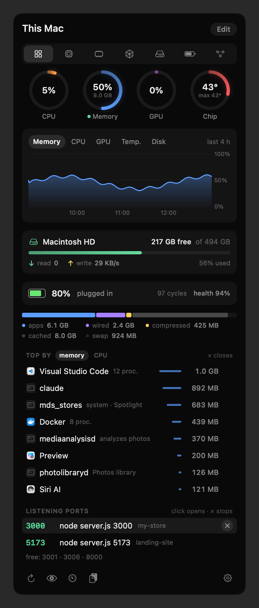
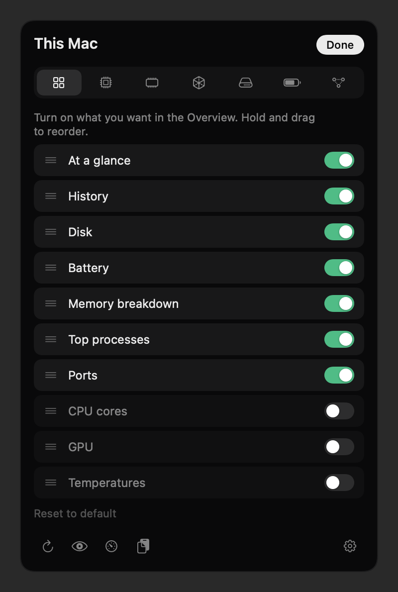
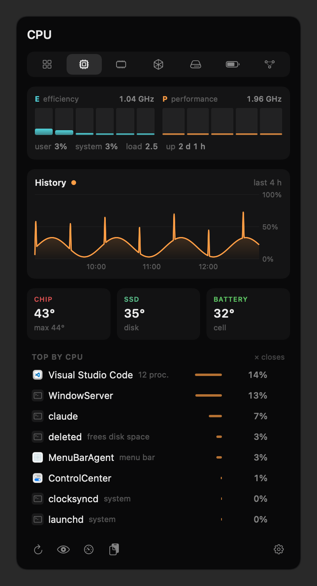
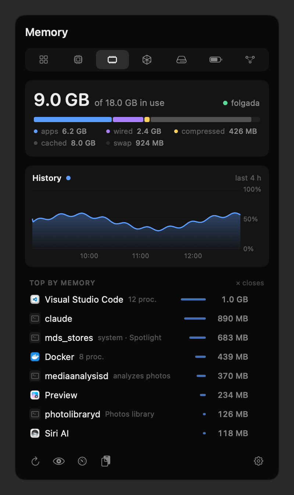
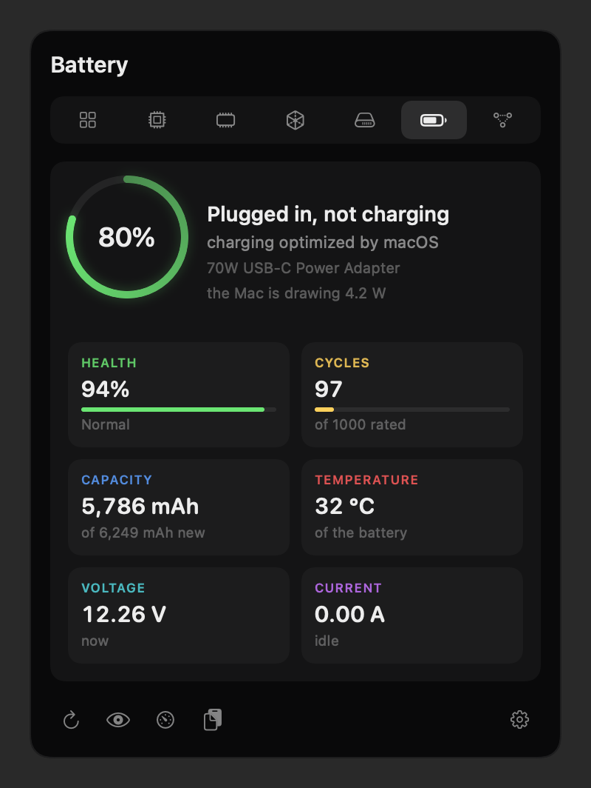
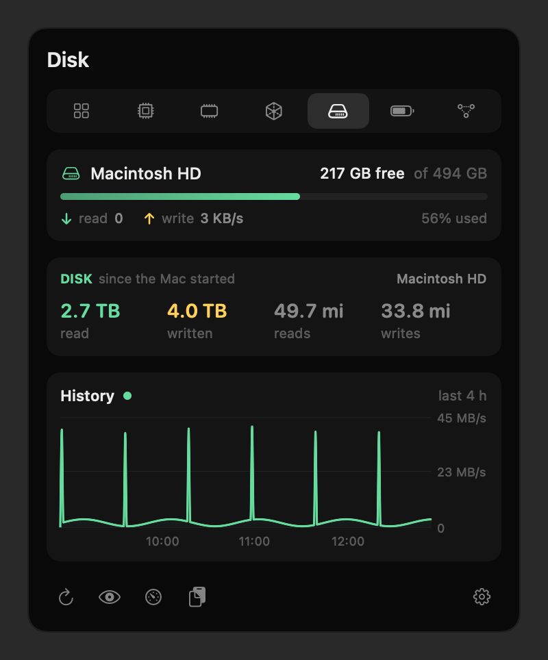
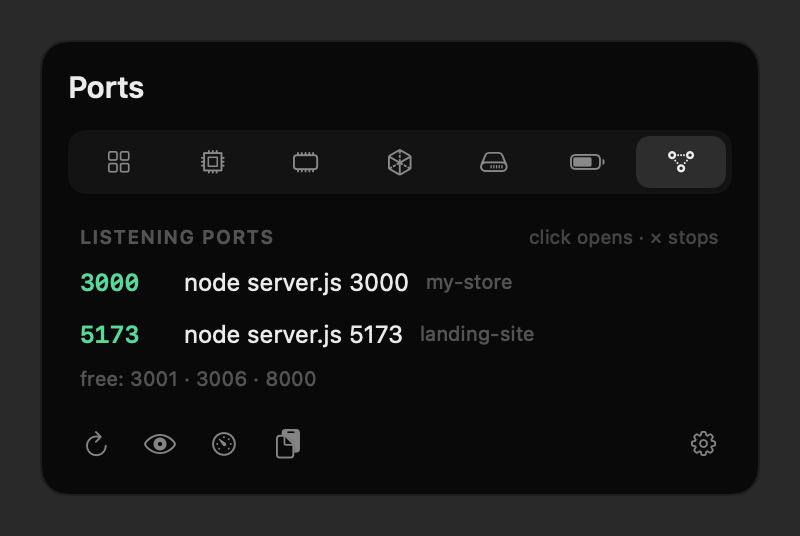

<div align="center">


# Barometer

**Your Mac, live, in the menu bar.**

Memory, CPU, GPU, disk, battery and temperatures in a black panel that opens with one click,
what is eating your Mac, and the ports left open, with a × to stop what shouldn't be running.

No account, no internet, nothing leaves your Mac.

**English** · [Português](README.pt-BR.md)

<br>



</div>

---

## What it shows

The menu bar icon is two small bars that rise and fall with CPU and memory, and the number next to them is how many
ports are listening. Click it and the panel opens. Every area has its own tab.

<table>
<tr>
<td width="50%" valign="top">

### Overview

The summary you build yourself. Out of the box: CPU, memory, GPU and chip temperature rings, a 6-hour chart, the
disk, the battery, the memory breakdown, top processes and the open ports. Hit **Edit** to switch each card on or
off and drag them into any order, like Control Center on the iPhone.

</td>
<td width="50%" valign="top">



</td>
</tr>
<tr>
<td valign="top">



</td>
<td valign="top">

### CPU

One bar per core, efficiency (E) and performance (P) cores apart, with each cluster's frequency in GHz. User and
system load, load average, uptime, a heads-up when the Mac gets hot, chip, SSD and battery temperatures, and the
processes using the most CPU.

</td>
</tr>
<tr>
<td valign="top">

### Memory

How much is in use and the memory pressure (the same one Activity Monitor shows), split into apps, wired,
compressed, cached and swap. Below it, the biggest users, grouped by app: Chrome and its thirty helper processes
become a single line.

</td>
<td valign="top">



</td>
</tr>
<tr>
<td valign="top">



</td>
<td valign="top">

### Battery

Charge level and time until empty or full. **Health** and **condition** match exactly what macOS shows in System
Settings. Plus the **cycle count** (and how many the battery is rated for), current versus original capacity,
temperature, voltage, current, how many watts the Mac is drawing right now, and which charger is plugged in.

</td>
</tr>
<tr>
<td valign="top">

### Disk and GPU

The disk with free space counted the way Finder counts it, live read and write speeds, and everything read and
written since the Mac started. The GPU with its usage, its renderer and tiler, the memory it's using and its core
count. Both with their own history chart.

</td>
<td valign="top">



</td>
</tr>
<tr>
<td valign="top">



</td>
<td valign="top">

### Ports

What is listening on each port, with the command and the **project name** (from `package.json` or the git folder).
For Docker, the container and its compose project. Click to open it in the browser; **×** stops it. Ports you use
all the time can become favorites, and then they show up as free when nothing is using them.

</td>
</tr>
</table>

## Languages

English, Portuguese and Spanish. Barometer follows your Mac's language; you can pick another one from the gear menu.

## Install

You need a Mac with Apple silicon, macOS 14 or later, and Apple's command line tools (`xcode-select --install` if
you don't have them yet). No Xcode, no Homebrew, no packages.

```sh
git clone https://github.com/GabrielTeles845/barometer.git
cd barometer
zsh instalar.sh
```

The installer compiles the app, builds `~/Applications/Barometer.app` and opens it. The icon shows up in the menu
bar, already set to open at login (you can turn that off in the gear menu). Running the installer again over an
existing install is safe.

## How to use it

- **Click the icon** to open the panel; click outside or press Esc to close it.
- **The tabs** at the top take you to each area. Hover to see their names.
- **Edit**, on the Overview, picks the cards and their order.
- **The ×** shows up when you hover a process or a port:
  - an **app** quits like Cmd+Q (it saves and asks whatever it needs to); if it hasn't quit after 5 seconds,
    Barometer offers to force it;
  - a **stray process** (a forgotten `npm run dev`, say) stops the whole job, like Ctrl+C in the terminal, not just
    the process holding the port;
  - a **Docker container** is stopped with `docker stop`;
  - **system processes** have no ×.
- **The gear** turns open-at-login on and off, changes the icon, picks favorite ports and the language.

## Where every number comes from

Nothing is estimated: each number comes from where macOS itself reads it.

| What | From |
|---|---|
| Memory and pressure | `host_statistics64` and `kern.memorystatus_vm_pressure_level` (the same math as Activity Monitor) |
| CPU per core | `host_processor_info`; each core's type from `cluster-type` in the device tree |
| CPU frequency | IOReport (time spent in each performance state) and the power controller's frequency table |
| Temperatures | The chip, SSD and battery sensors (Apple silicon HID services) |
| GPU | `IOAccelerator` → `PerformanceStatistics` |
| Disk | `IOBlockStorageDriver` → `Statistics`; free space the way Finder counts it |
| Battery | `AppleSmartBattery` and `IOPowerSources`; official health from `system_profiler` |
| Ports | `lsof`, the kernel's socket table; the project by walking up from the process folder |
| Processes | `ps`, grouped by app |

## Light on your Mac

- **Panel closed:** memory, CPU, temperature, GPU and disk every 10 seconds, through direct system calls, no new
  processes; ports every 3 seconds, through `lsof`. The chart keeps one reading per minute, 6 hours at most.
- **Panel open:** cores, the process list and the battery every 2 seconds, only while it's on screen.
- The official battery health runs at most every 10 minutes, and only with the Battery tab open.

## Safe to use

- **Nothing leaves your Mac.** No network, no account, no telemetry.
- **The × doesn't take down what it shouldn't.** It walks up the process tree to find the job and stops at the
  first shell: your terminal, your editor and your session are never targets. Finder, the Dock, the screen and
  Barometer itself have no ×. Before stopping anything, it checks that the process still owns the port (process
  numbers get reused). The proof is `provas/provar-encerrar.py`, which starts real processes and checks who dies.
- When it can't (a process owned by another user, a service that comes back on its own, a container that didn't
  stop), it tells you why instead of pretending it worked.

## Limits

- **Apple silicon only.** Temperatures and frequencies come from internal Apple interfaces, the same ones Stats and
  macmon use. They work from M1 to M3 Pro, where Barometer was tested; a new macOS release may change them.
- **No GPU frequency:** on the M3 Pro, Apple's state count doesn't line up with its frequency table (15 states, 13
  values), and showing a number there would be a guess.
- **The code is commented in Portuguese.** The interface speaks English, Portuguese and Spanish.

## For tinkerers

| File | What's in it |
|---|---|
| `barra.swift` | The app: icon, panel, actions, ports (`Sonda`), memory and processes (`Maquina`), sensors |
| `painel.swift` | The whole panel UI, in SwiftUI |
| `cpu.swift` | Cores and frequency (IOReport) |
| `gpu-disco.swift` | GPU and disk |
| `bateria.swift` | Battery |
| `idioma.swift` | Languages |
| `instalar.sh` | Compiles with `swiftc` and builds the `.app` |

- `barometer --retrato panel.png` draws the panel into an image and quits. The screenshots in this README come
  from it (`--aba bateria`, `--editar`, `--idioma en`). The chart uses a sample curve when the app has just
  started and has no hours of readings yet.
- The log lives in `~/Library/Logs/barometer.log`.

## Credits

[Stats](https://github.com/exelban/stats) (by Serhiy Mytrovtsiy) and [macmon](https://github.com/vladkens/macmon)
(by vladkens), both MIT, were the reference for where macOS keeps each reading. The idea of a complete panel in the
menu bar comes from iStat Menus. Barometer's code was written from scratch.

## License

MIT. See [LICENSE](LICENSE).
