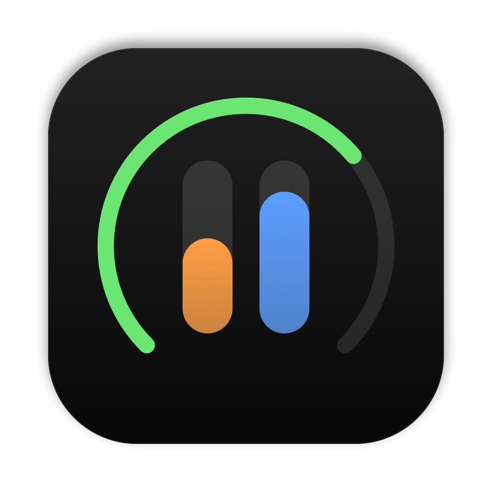
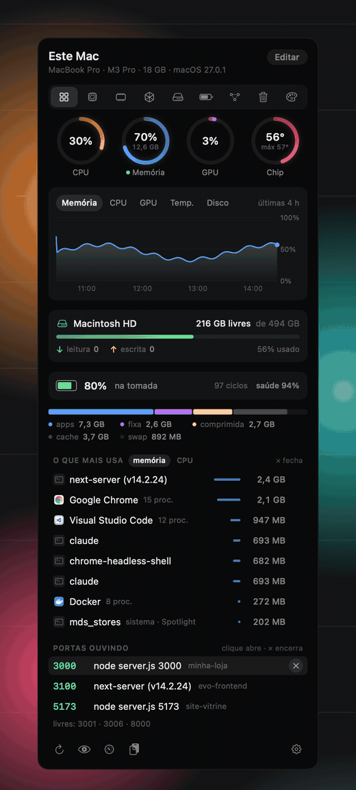

<div align="center">



# Barometer

**O seu Mac em tempo real, na barra de menus.**

Memória, CPU, GPU, disco, bateria e temperatura num painel que abre com um clique.<br>
O que mais está gastando, e as portas abertas, com um × para fechar o que ficou ligado à toa.

[](#instalar)
[](#limites)
[](#para-quem-quer-mexer)
[](LICENSE)
[](#idiomas)

[Instalar](#instalar) · [O que ele faz](#o-que-ele-faz) · [Como usar](#como-usar) · [English](README.md) · **Português**

<br>



</div>

## Instalar

Precisa de um Mac com chip da Apple, macOS 14 ou mais novo, e das ferramentas de linha de comando da Apple
(`xcode-select --install`). Sem Xcode, sem Homebrew, sem pacote nenhum.

```sh
git clone https://github.com/GabrielTeles845/barometer.git
cd barometer
zsh instalar.sh
```

O instalador compila, monta `~/Applications/Barometer.app` e abre, já marcado para abrir ao ligar o Mac (dá para
desligar na engrenagem). Rodar de novo por cima é seguro.

## O que ele faz

**Geral.** O resumo que você monta: anéis de CPU, memória, GPU e temperatura do chip, gráfico das últimas horas,
disco, bateria, memória por partes, o que mais gasta e as portas. Em **Editar**, cada cartão liga e desliga e muda de
lugar arrastando, e dá para escolher quantos processos as listas mostram (3, 5 ou 8).

**CPU.** Uma barra por núcleo, separando os de eficiência e os de desempenho, a frequência de cada grupo, a carga, há
quanto tempo o Mac está ligado, as temperaturas do chip, do SSD e da bateria, o que mais usa CPU e **quem mais
esquentou**: o tempo de CPU que cada app gastou nas últimas horas (até 6), para a tarde pesada ter nome. Também pode
ir para o Geral.

**Memória.** O uso e a pressão (a mesma do Monitor de Atividade), por partes: apps, fixa, comprimida, cache e swap.
Os que mais usam vêm agrupados por aplicativo: o Chrome com os trinta processos dele vira uma linha só.

**GPU e Disco.** Uso da GPU, renderer, tiler e memória. Espaço livre do jeito que o Finder conta, leitura e escrita
ao vivo, e o total desde que o Mac ligou. Os dois com gráfico.

**Bateria.** Carga, quanto falta, e a **saúde** e a **condição** iguais às dos Ajustes. Ciclos, capacidade,
temperatura, voltagem, watts e o carregador ligado.

**Portas.** O que está ouvindo em cada porta, com o comando e o nome do projeto (do `package.json` ou da pasta do
git); no Docker, o container e o projeto do compose. Clicar abre no navegador, o **×** encerra e o lápis dá um nome seu
à porta ("painel da loja"), que passa a aparecer na lista, nos avisos e na Limpeza. As favoritas aparecem como livres
quando ninguém está nelas.

**Limpeza.** Primeiro, o que dá para fechar: apps abertos e sem uso há mais de 1 hora (os que mais ocupam primeiro) e
servidores ligados há mais de 12 horas, como o `npm run dev` de ontem. Com dois ou mais servidores, **Encerrar os N
servidores** fecha todos com uma confirmação só, cada um do mesmo jeito cuidadoso do ×. Depois, cache dos apps, do npm, do Bun e do
pnpm, dados do Xcode, cache dos simuladores e registros antigos, cada um com o tamanho e o que acontece depois. A
Lixeira tem botão e confirmação próprios. Documentos, downloads e fotos nunca entram.

**Aparência.** Oito estilos prontos para escolher logo na primeira abertura, do Clássico ao Entardecer em vidro
líquido, e o **Personalizado**, em que você escolhe a cor de cada leitura. **Claro, escuro ou junto com o Mac**, e
nenhum estilo mexe nisso. Depois, do seu jeito: sólido (sempre fechado), ou fosco ou **vidro líquido** (macOS 26) com
régua de transparência, seis paletas, cor de destaque, **cores chapadas** para quem não gosta de brilho, **ícones coloridos**
em tudo, três tipos de canto, animação suave, com mola ou nenhuma, e ícone colorido na barra.

**Barra de menus.** Até três coisas lado a lado, cada uma com o seu ícone: uso de CPU, memória ou GPU, temperatura do
chip, bateria, disco livre, portas abertas, ou as barrinhas de CPU e memória.

## Como usar

- **Clique no ícone** para abrir o painel, ou aperte **⌃⌥B** em qualquer app; clique fora ou aperte Esc para fechar.
- **Teclado no painel:** ⌘1 a ⌘9 vão para cada aba, as setas passam de uma para a outra, ⌘R atualiza e ⌘, abre os
  ajustes.
- **Arraste a pílula das abas** pela barra: ela segue o mouse, estica com a velocidade e gruda na aba onde você solta.
- **Passe o mouse em qualquer ícone** para ver o nome, e **no gráfico** para ver a hora e o valor daquele ponto.
- **Editar**, no Geral, escolhe os cartões, a ordem e o que fica na barra.
- **O ×** aparece ao passar o mouse sobre um processo ou uma porta:
  - **aplicativo** fecha como o Cmd+Q; se não fechar em 5 s, oferece forçar;
  - **processo solto** (um `npm run dev` esquecido) encerra o trabalho inteiro, como o Ctrl+C no terminal;
  - **container do Docker** para com `docker stop`;
  - **processos do sistema** não têm ×.
- **A engrenagem** tem o abrir ao ligar o Mac, o que fica na barra, o atalho (⌃⌥B, ⌥⌘B, ⌃⌥Espaço, ⌃⌥M ou desligado),
  os avisos, as portas favoritas e o idioma.
- **Avisos**, todos desligados até você ligar: memória no limite por 1 minuto, chip acima de 95° por 30 segundos,
  disco com menos de 10% livre, bateria em 20% fora da tomada e porta favorita que caiu. Cada um sai uma vez e só
  volta depois que tudo normaliza.

## Leve de verdade

O Barometer só lê o que você está vendo.

- **Painel fechado:** memória, CPU, temperatura, GPU e disco a cada 10 s, por chamadas diretas ao sistema, para o
  ícone e o gráfico. Uma vez por minuto, um `ps` para o "quem mais esquentou". As portas (`lsof`) só se o número delas
  está na barra, ou se o aviso de porta favorita está ligado.
- **Painel aberto:** a cada 2 s, só o que a aba aberta mostra. A aba Aparência não lê nada; a aba Portas não lista
  processos.
- **Ao fechar o painel**, tudo o que ele desenhou sai da memória. Com o painel aberto, uns 30 MB.
- Um `ps` só para as duas listas de processos; a saúde oficial da bateria no máximo a cada 10 minutos, e só com a
  bateria na tela.

## Seguro de usar

- **Nada sai do seu Mac.** Sem rede, sem conta, sem telemetria.
- **O × não derruba o que não deve.** Ele sobe a árvore de processos até achar o trabalho e para no primeiro shell:
  o terminal, o editor e a sessão nunca entram no alvo. O Finder, o Dock e o próprio app não têm ×. Antes de
  encerrar, ele confere se o processo ainda é o dono da porta. A prova está em `provas/provar-encerrar.py`, que sobe
  processos de verdade e confere quem morre.
- Quando não consegue, ele diz por quê, em vez de fingir que fechou.

## De onde vem cada número

Nada é estimado: cada número sai de onde o próprio macOS lê.

| O quê | De onde |
|---|---|
| Memória e pressão | `host_statistics64` e `kern.memorystatus_vm_pressure_level` |
| CPU por núcleo | `host_processor_info`; o tipo de cada núcleo, do `cluster-type` na árvore de dispositivos |
| Frequência da CPU | IOReport e a tabela do controlador de energia |
| Temperaturas | Sensores do chip, do SSD e da bateria (serviços HID do chip da Apple) |
| GPU | `IOAccelerator` → `PerformanceStatistics` |
| Disco | `IOBlockStorageDriver` → `Statistics`; o espaço livre como o Finder conta |
| Bateria | `AppleSmartBattery`, `IOPowerSources`; a saúde oficial, do `system_profiler` |
| Portas | `lsof`; o projeto, subindo da pasta do processo |
| Processos | `ps`, agrupados por aplicativo |

## Limites

- **Só Mac com chip da Apple** (do M1 em diante). As temperaturas e a frequência vêm de interfaces internas da
  Apple, as mesmas que o Stats e o macmon usam. Testado num M3 Pro com macOS 27; em outro chip, um sensor ou um tipo
  de núcleo pode ter outro nome, e um macOS novo pode mudá-los. Se algo sair errado no seu Mac, abra uma issue
  dizendo o chip.
- **O vidro líquido precisa do macOS 26.** Nos anteriores, as duas opções de vidro aparecem apagadas e o painel fica
  no fosco. O vidro nunca leva tinta: no macOS 27 a tinta escura vira um bloco opaco, então a régua de transparência
  escurece uma camada à parte, por cima.
- **A frequência da GPU ficou de fora:** no M3 Pro a contagem da Apple não fecha com a tabela de frequências, e um
  número ali seria chute.

## Idiomas

Inglês, português e espanhol. O Barometer segue o idioma do Mac; dá para escolher outro na engrenagem.

## Para quem quer mexer

Um pacote Swift: a `BarometerKit` tem o app inteiro, uma pasta por assunto; o executável `Barometer` só dá a partida;
os testes usam a biblioteca direto.

| Pasta (`Sources/BarometerKit/`) | O que tem |
|---|---|
| `App/` | O comando do app, dividido por tarefa: leituras, ícone da barra, painel, ações, limpeza, ajustes, fotos |
| `Leitores/` | As leituras: memória e processos, CPU (IOReport), GPU, disco, bateria, histórico, limpeza, modelo do Mac |
| `Portas/` | As portas: a varredura do `lsof`, os projetos e quem o × encerra |
| `Sistema/` | Sensores, ferramentas, diário, abrir ao ligar, preferências |
| `Painel/` | O painel em SwiftUI: estado, abas, editor; `Cartoes/` (cartões) e `Pecas/` (peças pequenas reaproveitadas) |
| `Aparencia/` | Fundos, vidro líquido, paletas, animações, a aba Aparência |
| `BarraDeMenus/` | O desenho do ícone da barra |
| `Idioma/` | Os idiomas e as traduções |

```sh
swift build          # compilar
swift test           # rodar os testes
zsh instalar.sh      # montar ~/Applications/Barometer.app
```

- `barometer --retrato painel.png` desenha o painel numa imagem e sai (`--aba cpu`, `--editar`, `--idioma pt`,
  `--fundo vidro`, `--paleta neon`). O vidro não se desenha fora da tela: nessas imagens ele é imitado desfocando o
  papel de parede atrás; na tela, é o material do macOS de verdade.
- `barometer --abrir` já abre com o painel aberto, para medir memória e CPU.
- O diário fica em `~/Library/Logs/barometer.log`.

## Créditos

O [Stats](https://github.com/exelban/stats) (de Serhiy Mytrovtsiy) e o [macmon](https://github.com/vladkens/macmon)
(de vladkens), ambos MIT, foram a referência de onde o macOS guarda cada leitura. A ideia de um painel completo na
barra vem do iStat Menus. O código do Barometer foi escrito do zero.

## Licença

MIT. Veja [LICENSE](LICENSE).
