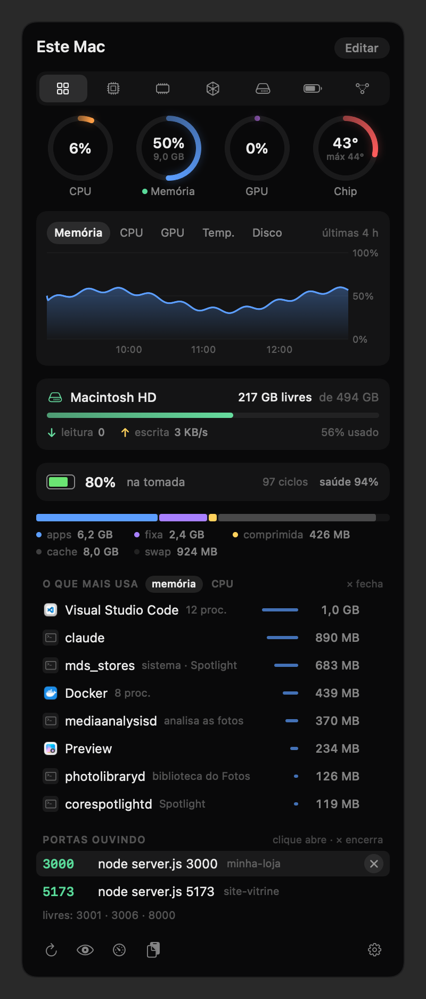
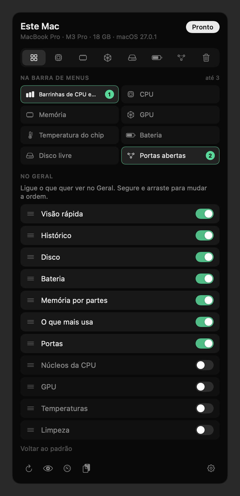
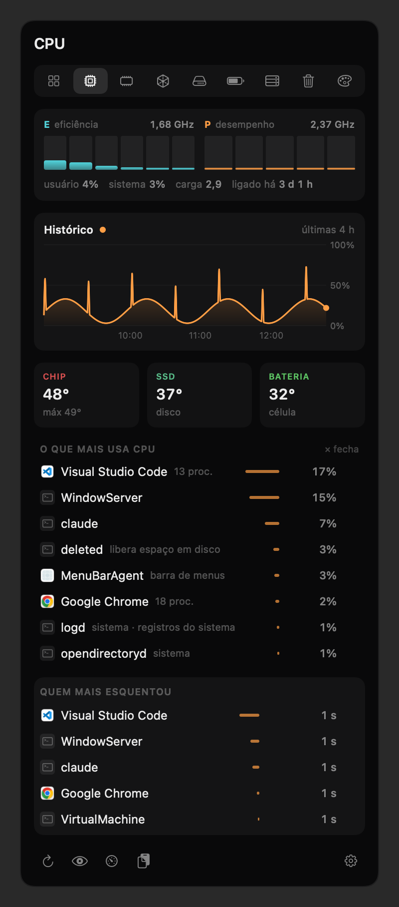
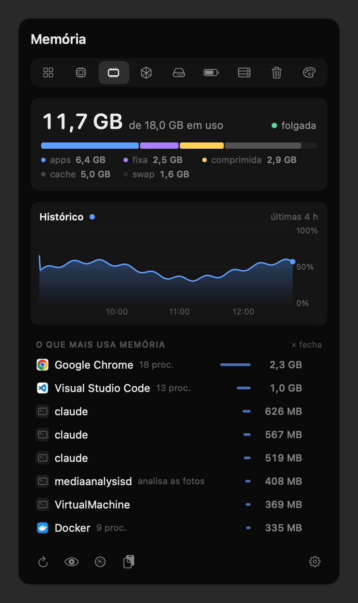
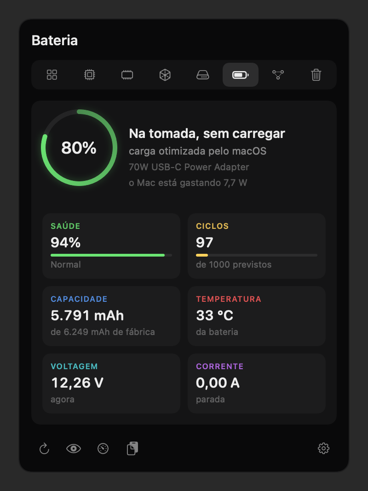
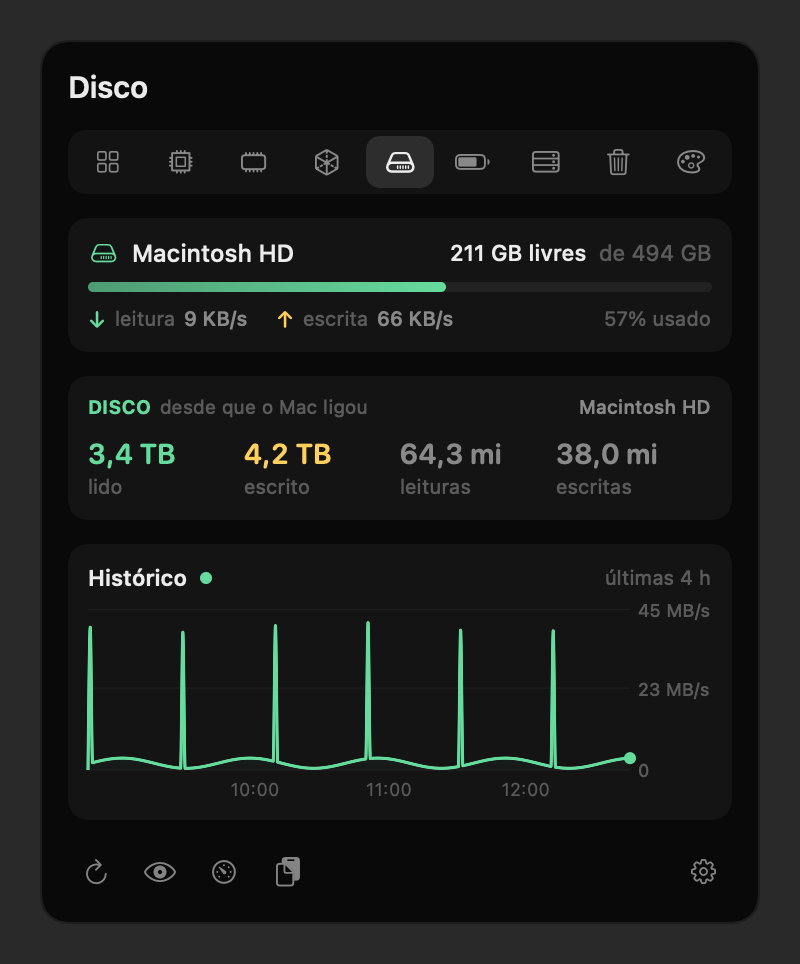
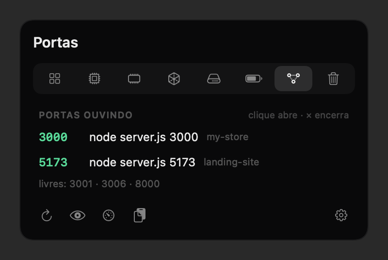
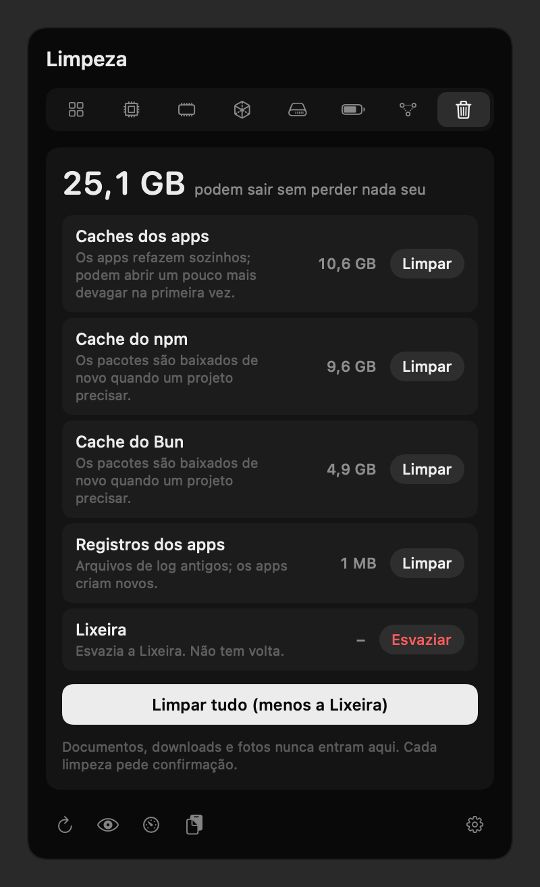
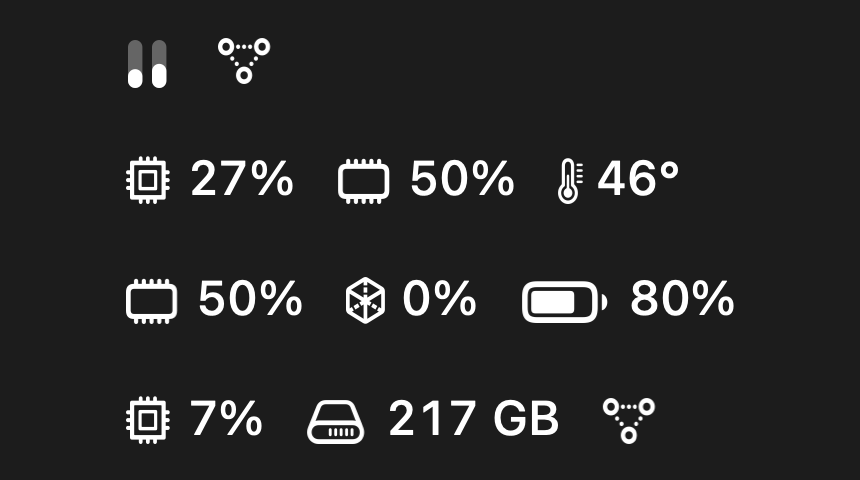

<div align="center">


# Barometer

**O seu Mac em tempo real, na barra de menus.**

Memória, CPU, GPU, disco, bateria e temperatura num painel preto que abre com um clique,
o que mais está gastando, e as portas abertas com um × para fechar o que ficou ligado à toa.

Sem conta, sem internet, sem nada saindo do seu Mac.

[English](README.md) · **Português**

<br>



</div>

---

## O que ele mostra

O ícone na barra são duas barrinhas que sobem e descem com a CPU e a memória, e o número ao lado é quantas portas
estão abertas. Clicou, abre o painel. Cada área tem a sua aba.

<table>
<tr>
<td width="50%" valign="top">

### Geral

O resumo que você monta, embaixo do modelo do Mac, do chip, da memória e da versão do macOS. Vem com os anéis de CPU, memória, GPU e temperatura do chip, o gráfico das últimas 6 horas,
o disco, a bateria, a memória por partes, o que mais está gastando e as portas. Em **Editar**, cada cartão tem um
interruptor e você arrasta para mudar a ordem, como na Central de Controle do iPhone.

</td>
<td width="50%" valign="top">



</td>
</tr>
<tr>
<td valign="top">



</td>
<td valign="top">

### CPU

Uma barra por núcleo, separando os de eficiência (E) e os de desempenho (P), com a frequência de cada grupo em GHz.
Uso do usuário e do sistema, carga média, há quanto tempo o Mac está ligado, aviso quando ele esquenta, as
temperaturas do chip, do SSD e da bateria, e os processos que mais usam CPU.

</td>
</tr>
<tr>
<td valign="top">

### Memória

Quanto está em uso, a pressão (folgada, apertada ou no limite, a mesma do Monitor de Atividade) e a memória por
partes: apps, fixa, comprimida, cache e swap. Embaixo, os que mais usam memória, agrupados por aplicativo: o Chrome
com os trinta processos dele vira uma linha só.

</td>
<td valign="top">



</td>
</tr>
<tr>
<td valign="top">



</td>
<td valign="top">

### Bateria

A carga e quanto falta para acabar ou para encher. A **saúde** e a **condição** são as mesmas que o macOS mostra
nos Ajustes. Também: os **ciclos** (e quantos a bateria foi feita para aguentar), a capacidade atual contra a de
fábrica, temperatura, voltagem, corrente, quanto o Mac está gastando em watts e qual carregador está ligado.

</td>
</tr>
<tr>
<td valign="top">

### Disco e GPU

O disco com o espaço livre do jeito que o Finder conta, leitura e escrita ao vivo, e o total lido e escrito desde
que o Mac ligou. A GPU com o uso, as partes dela (renderer e tiler), a memória que ela está usando e o número de
núcleos. Os dois com gráfico das últimas horas.

</td>
<td valign="top">



</td>
</tr>
<tr>
<td valign="top">



</td>
<td valign="top">

### Portas

O que está ouvindo em cada porta, com o comando e o **nome do projeto** (do `package.json` ou da pasta do git). No
Docker, o container e o projeto do compose. Clicar abre no navegador; o **×** encerra. As portas que você usa sempre
podem virar favoritas, e aí aparecem como livres quando ninguém está nelas.

</td>
</tr>
<tr>
<td valign="top">

### Limpeza

O que pode sair sem perder nada seu: cache dos apps, do npm, do Bun e do pnpm, dados derivados do Xcode, cache dos
simuladores e registros antigos, cada um com o tamanho e o que acontece depois de limpar. **Limpar tudo** num clique,
ou um por um. A Lixeira tem o próprio botão e a própria confirmação, porque não tem volta. Documentos, downloads e
fotos nunca entram.

</td>
<td valign="top">



</td>
</tr>
</table>

## A barra de menus do seu jeito

Escolha até três coisas para ficar na barra de menus, cada uma com o seu ícone: uso de CPU, memória ou GPU,
temperatura do chip, bateria, disco livre, portas abertas, ou as barrinhas de CPU e memória. A escolha fica em
**Editar**, no Geral, ou na engrenagem.



## Idiomas

Inglês, português e espanhol. O Barometer segue o idioma do Mac; dá para escolher outro na engrenagem.

## Instalar

Precisa de um Mac com chip da Apple, macOS 14 ou mais novo, e das ferramentas de linha de comando da Apple
(`xcode-select --install`, se ainda não tiver). Sem Xcode, sem Homebrew, sem pacote nenhum.

```sh
git clone https://github.com/GabrielTeles845/barometer.git
cd barometer
zsh instalar.sh
```

O instalador compila, monta `~/Applications/Barometer.app` e abre. O ícone aparece na barra de menus, e o app já
fica marcado para abrir ao ligar o Mac (dá para desligar na engrenagem). Rodar o instalador de novo por cima é seguro.

## Como usar

- **Clique no ícone** para abrir o painel; clique fora ou aperte Esc para fechar.
- **As abas** no topo levam a cada área. Passe o mouse para ver o nome.
- **Editar**, no Geral, escolhe os cartões e a ordem.
- **O ×** aparece ao passar o mouse sobre um processo ou uma porta:
  - **aplicativo** fecha como o Cmd+Q (ele salva e pergunta o que precisar); se não fechar em 5 s, oferece forçar;
  - **processo solto** (um `npm run dev` esquecido, por exemplo) encerra o trabalho inteiro, como o Ctrl+C no
    terminal, e não só o processo que ouve a porta;
  - **container do Docker** para com `docker stop`;
  - **processos do sistema** não têm ×.
- **A engrenagem** liga e desliga o abrir ao ligar o Mac, escolhe o que fica na barra, as portas favoritas e o idioma.

## De onde vem cada número

Nada é estimado: cada número sai de onde o próprio macOS lê.

| O quê | De onde |
|---|---|
| Memória e pressão | `host_statistics64` e `kern.memorystatus_vm_pressure_level` (as mesmas contas do Monitor de Atividade) |
| CPU por núcleo | `host_processor_info`; o tipo de cada núcleo, do `cluster-type` na árvore de dispositivos |
| Frequência da CPU | IOReport (o tempo em cada estado de desempenho) e a tabela do controlador de energia |
| Temperaturas | Os sensores do chip, do SSD e da bateria (serviços HID do Apple Silicon) |
| GPU | `IOAccelerator` → `PerformanceStatistics` |
| Disco | `IOBlockStorageDriver` → `Statistics`; o espaço livre como o Finder conta |
| Bateria | `AppleSmartBattery` e `IOPowerSources`; a saúde oficial, do `system_profiler` |
| Portas | `lsof`, a tabela de sockets do kernel; o projeto, subindo da pasta do processo |
| Processos | `ps`, agrupados por aplicativo |

## Leve de verdade

- **Painel fechado:** memória, CPU, temperatura, GPU e disco a cada 10 s, por chamadas diretas ao sistema, sem
  abrir processo novo; as portas a cada 3 s, pelo `lsof`. O gráfico guarda uma leitura por minuto, 6 horas no máximo.
- **Painel aberto:** os núcleos, a lista de processos e a bateria a cada 2 s, só enquanto ele está na tela.
- A saúde oficial da bateria roda no máximo a cada 10 minutos, e só com a aba Bateria aberta.

## Seguro de usar

- **Nada sai do seu Mac.** Sem rede, sem conta, sem telemetria.
- **O × não derruba o que não deve.** Ele sobe a árvore de processos até achar o trabalho e para no primeiro shell:
  o terminal, o editor e a sessão nunca entram no alvo. O Finder, o Dock, a tela e o próprio app não têm ×. Antes de
  encerrar, ele confere se aquele processo ainda é o dono da porta (o número do processo pode ter sido reaproveitado).
  A prova está em `provas/provar-encerrar.py`, que sobe processos de verdade e confere quem morre.
- Quando não consegue (processo de outro usuário, serviço que reabre sozinho, container que não parou), ele diz por
  quê, em vez de fingir que fechou.

## Limites

- **Só Mac com chip da Apple.** As temperaturas e a frequência vêm de interfaces internas da Apple, as mesmas que o
  Stats e o macmon usam. Funcionam do M1 ao M3 Pro, onde foi testado; um macOS novo pode mudá-las.
- **A frequência da GPU ficou de fora:** no M3 Pro a contagem da Apple não fecha (15 estados para 13 valores), e
  mostrar um número ali seria chute.

## Para quem quer mexer

| Arquivo | O que tem |
|---|---|
| `barra.swift` | O app: ícone, painel, ações, portas (`Sonda`), memória e processos (`Maquina`), sensores |
| `painel.swift` | Todo o desenho do painel, em SwiftUI |
| `cpu.swift` | Núcleos e frequência (IOReport) |
| `gpu-disco.swift` | GPU e disco |
| `bateria.swift` | Bateria |
| `limpeza.swift` | Limpeza e o modelo do Mac |
| `idioma.swift` | Os idiomas |
| `instalar.sh` | Compila com o `swiftc` e monta o `.app` |

- `barometer --retrato painel.png` desenha o painel numa imagem e sai. As fotos deste README saem daí
  (`--aba bateria`, `--editar`, `--idioma pt`). O gráfico usa uma curva de exemplo quando o app acabou de abrir e
  ainda não tem horas de leitura.
- O diário fica em `~/Library/Logs/barometer.log`.

## Créditos

O [Stats](https://github.com/exelban/stats) (de Serhiy Mytrovtsiy) e o [macmon](https://github.com/vladkens/macmon)
(de vladkens), ambos MIT, foram a referência de onde o macOS guarda cada leitura. A ideia de um painel completo na
barra vem do iStat Menus. O código do Barometer foi escrito do zero.

## Licença

MIT. Veja [LICENSE](LICENSE).
